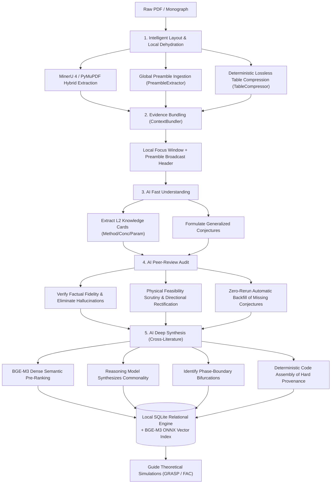

# AtomicCalculationsDB (V3.0.0)

<p align="center">
  
</p>

<p align="center">
  <strong>Local-First Scientific Intelligence Platform for Computational Atomic Physics: Literature Retrieval, Knowledge Card Distillation, and Theoretical Calculation Guidance</strong>
</p>

<p align="center">
  <strong>English</strong> •
  <a href="README_zh.md">简体中文</a>
</p>

<p align="center">
  <a href="#-project-overview">Overview</a> •
  <a href="#-core-philosophy--breakthroughs">Core Philosophy</a> •
  <a href="#-three-tier-knowledge-graph-model">Three-Tier Model</a> •
  <a href="#-pipeline-architecture--operational-principles">Pipeline Architecture</a> •
  <a href="#-guiding-theoretical-calculations">Guiding Calculations</a> •
  <a href="#-dual-mode-execution-architecture">Dual-Mode Architecture</a> •
  <a href="#-quick-start">Quick Start</a> •
  <a href="#-version-evolution--task-archive">Task Archive</a>
</p>

---

## 📖 Project Overview

**AtomicCalculationsDB** is a **local-first literature retrieval, structured knowledge distillation, and theoretical calculation decision-support system** engineered specifically for **computational atomic and molecular physics** (focusing on high-precision relativistic many-body methods including MCDHF, RCI, RMBPT, Coupled-Cluster, and CI+MBPT).

Generic LLMs and conventional RAG pipelines break down when tackling scientific literature due to four fundamental failure modes: **long-range premise drop-off**, **token explosion across dense numerical tables**, **lack of physical extrapolative commonsense**, and **citation hallucination**. AtomicCalculationsDB overcomes these barriers by establishing an end-to-end scientific research loop:

> **PDF Layout Parsing** ➜ **Global Preamble Ingestion** ➜ **Deterministic Table Compression** ➜ **L2 Card Extraction** ➜ **Cross-Review Audit** ➜ **Deep Synthesis & Hard Provenance**

---

## 💡 Core Philosophy & Breakthroughs

In computational atomic physics, off-the-shelf LLMs frequently produce catastrophic errors. AtomicCalculationsDB is constructed on five core methodological breakthroughs:

### 1. Conclusion Harvesting + Local Focus + Global Preamble Ingestion
* **The Problem**: Scientific papers typically formulate foundational axioms in one brief sentence within the Abstract or Methods section—e.g., *"atomic units (a.u.) are used throughout"*, *"Fermi two-parameter nuclear charge distribution is adopted"*, *"1s core is frozen"*, or *"Coulomb gauge is selected"*. Standard chunking (e.g. 500-token sliding windows) causes downstream chunks to lose these initial premises, forcing the AI into severe order-of-magnitude hallucinations.
* **The Solution**:
  - **Global Preamble Ingestion**: The `PreambleExtractor` scans preambles and theoretical methodology sections to harvest calculation baselines;
  - **Conclusion Harvesting & Local Focus**: Semantic algorithms identify representative conclusion sentences across the full paper and construct local sliding windows capturing tightly coupled boundary conditions (configuration states, perturbation orders, correlation models);
  - **Broadcast Ingestion**: Global calculation axioms are broadcast to the top of every downstream evidence bundle, eliminating context disconnect.

### 2. Deterministic Code-Level Table Pre-compression
* **The Problem**: Atomic calculations generate high-density, multi-dimensional numerical tables (energy levels, transition probabilities, branching ratios, Stark/Zeeman coefficients). Feeding raw tables to LLMs squanders over 40% of tokens on repeated units (`eV`, `s⁻¹`) and human-aligned spacing, while degrading self-attention fidelity.
* **The Solution**: The deterministic `TableCompressor` algorithm dehydrates tables prior to model ingestion:
  - Detects and strips monotonic index columns (`No.`, `Index`, `#`);
  - Scans column values, extracting common physical units and magnitude factors (`10⁸ s⁻¹`) and hoisting them into the header;
  - Strips empty whitespace while preserving header semantics, significant digits, and critical footnotes—**reducing token consumption by 30%–45% with 100% precision**.

### 3. Transition from Isolated Numbers to Generalized Physical Conjectures
* **The Problem**: Published papers report numbers for specific isolated ions. Theoretical physicists, however, seek underlying trends and scaling behaviors.
* **The Solution**: Pure numerical values are isolated. When evidence reflects physical mechanisms or non-trivial anomalies, the LLM is guided to formulate a grounded **generalized physical conjecture** (`generalized_conjecture`—e.g. isoelectronic hydrogenic scaling $Z^4$, competition between relativistic contraction and electron correlation), seeding future cross-paper inductive synthesis.

### 4. Polarity Alignment & Phase-Boundary Deep Synthesis
* **The Problem**: Different publications frequently arrive at divergent or conflicting conclusions (e.g., Paper A attributes a transition rate suppression to Breit interaction, whereas Paper B attributes enhancement to configuration mixing). Generic AI either averages them out or ignores the conflict.
* **The Solution**:
  - **Unified Commonality**: Distills universal mechanisms invariant across nuclear charge $Z$;
  - **Phase-Boundary Bifurcations**: Pinpoints the exact computational or physical divergence threshold (e.g., electron correlation dominating at low $Z$, superseded by relativistic retardation at high $Z$).

### 5. Algorithmic Hard Provenance Chain
* **The Problem**: LLMs frequently fabricate authors, years, and page numbers when summarizing cross-paper literature.
* **The Solution**: **Synthesis reasoning is handled by the model, but citation assembly is 100% handled by deterministic Python code**. The system queries the local SQLite engine directly using the metadata of participating L2 cards, assembling `DOC-ID`, paper titles, section hierarchy (`source_section`), page indices, and table tags into a tamper-proof `provenance_chain`.

---

## 🏛️ Three-Tier Knowledge Graph Model

The system organizes domain knowledge into a strictly decoupled, hierarchical three-tier graph:

| Tier | Knowledge Form | Core Fields & Payloads | Physical Purpose |
| :--- | :--- | :--- | :--- |
| **L1** | **Master Synthesis Card** | `unified_commonality`<br>`bifurcations`<br>`provenance_chain` (deterministic) | **Macro Guidance**: Identifies universal laws, scaling behaviors, and critical dispute boundaries across isoelectronic sequences. |
| **L2** | **Knowledge Cards** | **Method Cards (STRAT)**: Algorithms, orbital active space, convergence criteria<br>**Conclusion Cards (CONC)**: Findings, `generalized_conjecture`<br>**Parameter Cards (PARAM)**: Potentials, grid steps, nuclear parameters | **Micro Particle**: Self-contained, rigorously conditioned calculation facts. |
| **L3** | **Raw Evidence** | MinerU 4 / PyMuPDF block bounding boxes (`bbox`)<br>Markdown text slices<br>`TableBlock` & `FigureBlock` | **Auditable Base**: Enables pixel-level visual trace back to the exact physical page, table, and paragraph in the source PDF. |

---

## ⚙️ Pipeline Architecture & Operational Principles

The system operates across five coordinated pipeline stages:



### 1. Semantic Analysis: Global Preambles & Local Conclusions
- **Preamble Ingestion**: `PreambleExtractor` inspects initial sections using dual-token filters (declarative cues: `throughout this work`, `in all calculations` + domain terms: `atomic units`, `fermi`, `frozen core`, `breit`, `gauge`).
- **Local Focus**: Conclusion extractors scan the document, establish sliding windows around focal conclusions, and capture configuration states and perturbation models.
- **Context Injection**: Combines broadcast global axioms with local windows into high signal-to-noise `ContextBundles`.

### 2. AI Fast Understanding & Conjectures
- Structured prompt templates extract conditions, numerical results, and equations.
- Enforces grounded physical extrapolation (e.g. isoelectronic scaling, correlation vs. relativistic competition).

### 3. AI Peer-Review Audit
- **Fidelity Verification**: Cross-validates card claims against source slices to eliminate hallucination.
- **Physical Feasibility Check**: Audits whether theoretical conjectures hold under quantum electrodynamics and relativistic many-body principles.
- **Zero-Rerun Backfill**: Enhances legacy cards with generalized conjectures during regular auditing without reprocessing entire documents.

### 4. Deep Synthesis: Conjectures ➜ Similarity ➜ Commonality ➜ Provenance
- **Vector Pre-ranking**: Local BGE-M3 encodes candidate conclusions to retrieve Top-$K$ relevant candidates.
- **Deep Synthesis & Bifurcations**: Reasoning LLMs synthesize `unified_commonality` and formulate `bifurcations` for conflicting results.
- **Hard Provenance Assembly**: Backend code resolves paper metadata directly from SQLite, binding verifiable citations.

---

## 🎯 Guiding Theoretical Calculations

AtomicCalculationsDB serves as an **intelligent desktop copilot for computational atomic theorists**:

### 1. Active Space Scaling Prescriptions
- **The Problem**: In Multiconfiguration Dirac-Hartree-Fock (MCDHF), choosing virtual orbital expansion depths ($n=4, 5, 6\dots$) and excitation schemes (SD, SDT) is tricky—insufficient basis sets lead to inaccuracy, while over-expansion crashes HPC memory.
- **Guidance**: The system queries historical convergence curves for matching isoelectronic sequences and recommends **optimal cutoff layers and excitation combinations** (e.g.: *"For this state, Core-Valence (CV) accounts for 85% of correlation; Core-Core (CC) can remain frozen at target accuracy. Recommended cutoff: $n=4$"*), saving 60%+ in computational overhead.

### 2. Hamiltonian Decision Trees (Breit & QED)
- **The Problem**: Knowing when the Breit interaction or higher-order QED (self-energy and vacuum polarization) must be included self-consistently versus as first-order perturbations.
- **Guidance**: Tracks scaling boundaries as a function of nuclear charge $Z$. Alerts researchers when retardation effects become critical, using historic Coulomb/Babushkin gauge discrepancies as a gauge-invariance quality baseline.

### 3. One-Click Synthesis of Program Input Decks
- Compiles distilled configuration active spaces, angular momentum couplings, and potential parameters directly into native input files:
  - **GRASP2018**: Generates `rcsfgenerate` configuration expansions, `rmcdhf` variational weights, and `rci` interaction decks;
  - **FAC (Flexible Atomic Code)**: Generates standardized automation scripts.

### 4. Real-time Simulation Anomaly Radar
- Upon importing new calculations, the system checks results against historical trends:
  - Verifies compliance with isoelectronic scaling laws;
  - In dispute zones, flags agreement: *"Current values align with Paper A, indicating sufficient virtual orbital absorption of the relaxation channel"*.

---

## 🚀 Dual-Mode Execution Architecture

The system provides flexible execution for both high-throughput automation and zero-cost local operation:

```
                    ┌──────────────────────────────┐
                    │    Execution Mode Dialog     │
                    └──────────────┬───────────────┘
                                   │
               ┌────────────────────┴────────────────────┐
               ▼                                         ▼
   【API Automated Model Pool】               【Zero-Token Web AI Semi-Auto】
  - Multi-endpoint pool scheduling          - Zero API token cost
  - Dynamic 4-role routing                  - Single-doc isolation (no cross-contamination)
  - Token-adaptive packaging & relay        - Flat document list (10-row viewport + scroll)
  - Vision switch toggle to cut waste       - Pack slots (10-row viewport + modal entry)
```

1. **API Automated Model Pool**:
   - **Decoupled Architecture**: Pool Nodes ➜ Schedule Strategy ➜ Dynamic 4-Role Routing (`AI Fast Understanding`, `AI Peer-Review`, `AI Deep Synthesis`, `AI Vision Understanding`);
   - Independent vision toggle prevents unnecessary multimodal token expenditure;
   - `DynamicBatchPacker` auto-sizes payloads according to node capacity with failover relay.
2. **APG-Style Semi-Automatic Mode (Zero API Cost)**:
   - **Single-Doc Isolation**: Guaranteeing packets contain slices from strictly one paper at a time;
   - **Flat Document Viewport**: Displays 7 dimensions (DOC-ID, Title, Type, Year, Journal, Authors, Tokens) in a smooth **10-row viewport with dedicated scrollbars**;
   - **Standardized Question Packs**: Card slots equipped with `#01`, `#02` line labels, 10-row viewport, `📋 Copy Prompt`, `📎 Copy Figures PDF` (placeholder), `📥 Import File`, `📝 Paste Response` (modal JSON editor), and controlled `🚀 Step 2: Write to Knowledge Base`.

---

## 🔐 Security & Credential Protection

- **Decoupled Storage**: API keys and endpoint parameters are completely separated from [config.yaml](workspace/config.yaml), stored exclusively in `workspace/model_pool.enc`.
- **OS-Level DPAPI Hardware Binding**: Utilizes Windows Data Protection API (`DPAPI`: `CryptProtectData` / `CryptUnprotectData` via `ctypes`), binding encryption to the active Windows user profile. Copied files cannot be decrypted on other machines.
- **Repository Safety**: All encryption files (`*.enc`), databases, and binary caches are strictly ignored by [.gitignore](.gitignore).

---

## 📦 Quick Start

### Option A: Standalone Package (Recommended, No Python Required)

1. Download the latest release from the [GitHub Releases Page](https://github.com/YOUNG-YUAN/AtomicCalculationsDB/releases):
   - **Full Standalone Package**: `AtomicCalculationDB_Full_v3.0.0.zip` (~1.7 GB, includes embedded Python runtime and 1024-dim BGE-M3 ONNX local embedding engine; **pure CPU execution, no GPU required**).
2. Extract to an ASCII path and launch **`AtomicCalculationDB.exe`**.

### Option B: Run from Source (Developers)

```bash
# 1. Clone repository
git clone https://github.com/YOUNG-YUAN/AtomicCalculationsDB.git
cd AtomicCalculationsDB

# 2. Install dependencies (Python 3.10 or 3.11 recommended)
pip install -r requirements.txt

# 3. Verify environment with test suite (196 tests passing)
pytest

# 4. Launch GUI desktop application
python launcher.py
```

---

## 🗂️ Version Evolution & Task Archive

All historical engineering specs, bugfix records, and architectural task documents are organized inside the [update_log/](update_log/) directory:

| Document | Milestone / Topic | Highlights |
| :--- | :--- | :--- |
| **[Creation.md](update_log/AtomicCalculationsDB_Creation.md)** | **Initial Blueprint** | Origin, atomic physics RAG failure analysis, system blueprint |
| **[UpdateTask_01.md](update_log/UpdateTask_01.md)** | **v2.0.0** | 5-step pipeline architecture, SQLite+Qdrant, base GUI |
| **[UpdateTask_02.md](update_log/UpdateTask_02.md)** | **v2.1.0** | Standalone EXE packaging specs, 24/7 worker engine |
| **[UpdateTask_03.md](update_log/UpdateTask_03.md)** | **v2.2.0** | Markdown equation rendering, 4-tier metadata extraction, token tracking |
| **[UpdateTask_04.md](update_log/UpdateTask_04.md)** | **v2.3.0** | Unified compute pool, decoupled policies, AI Studio CDP bridge |
| **[UpdateTask_05.md](update_log/UpdateTask_05.md)** | **v2.4.0** | Cross-model card audit, batch review bundles, local backfill |
| **[UpdateTask_06.md](update_log/UpdateTask_06.md)** | **v2.5.0** | MinerU 4 OCR engine integration, block-level PDF coordinates |
| **[UpdateTask_07.md](update_log/UpdateTask_07.md)** | **v2.6.0** | Dual-path Agent integration (MCP protocol support) |
| **[UpdateTask_08~10.md](update_log/UpdateTask_08.md)** | **v2.7–2.9** | Local ONNX engine migration, anomaly radar debouncing, memory safety |
| **[UpdateTask_11.md](update_log/UpdateTask_11.md)** | **v3.0.0 (Latest)** | **Preamble Ingestion, Lossless Table Compression, Generalized Conjectures, Hard Provenance, 10-Row Viewport, Windows DPAPI Encryption** |
| **[FixTask_*.md (27 Files)](update_log/)** | **v2.2–v2.9 Patches** | 27 rigorous bugfix records (memory optimizations, ETA estimation, queue retries) |

---

## 📄 License & Acknowledgements

- Licensed under the **MIT License**.
- **Theoretical Physics & Document Parsing**:
  - [GRASP2018](https://github.com/compas/grasp2018) (CompAS Collaboration): For foundational contributions to relativistic atomic structure theory and multiconfiguration Dirac-Hartree-Fock calculations;
  - [MinerU](https://github.com/opendatalab/MinerU) (OpenDataLab): For state-of-the-art academic document layout parsing and extraction of complex scientific tables and formulas.
- **Local Lightweight Neural Engines**:
  - [ONNX Runtime](https://github.com/microsoft/onnxruntime) (Microsoft) & [Hugging Face](https://huggingface.co/): For high-performance, pure-CPU neural inference runtime;
  - [BGE-M3](https://github.com/FlagOpen/FlagEmbedding) (BAAI): For powerful dense and multi-granularity scientific embedding in hybrid literature retrieval;
  - [Sentence-Transformers](https://www.sbert.net/) (MiniLM) & [DeBERTa-v3](https://github.com/microsoft/DeBERTa) (Microsoft): For lightweight, GPU-free semantic clustering, reranking, and NLI polarity conflict detection.
