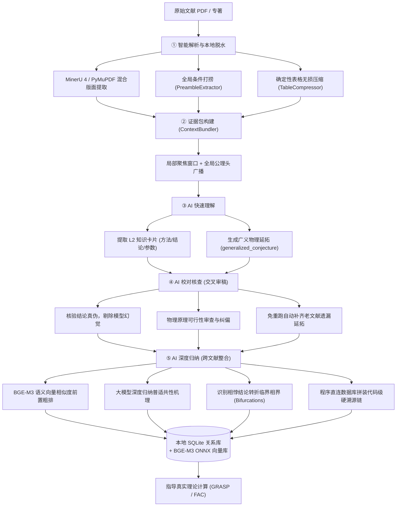

# AtomicCalculationsDB (V3.0.0)

<p align="center">
  
</p>

<p align="center">
  <strong>面向计算原子物理的本地优先智能文献检索、知识卡片沉淀与理论计算指导系统</strong>
</p>

<p align="center">
  <a href="README.md">English</a> •
  <strong>简体中文</strong>
</p>

<p align="center">
  <a href="#核心思路与设计哲学">核心思路</a> •
  <a href="#运行原理与五步架构流水线">运行原理</a> •
  <a href="#三层知识图谱模型">三层知识模型</a> •
  <a href="#如何指导理论计算">指导理论计算</a> •
  <a href="#双模执行与工程架构">双模工程架构</a> •
  <a href="#快速开始">快速开始</a> •
  <a href="#版本演进与任务档案">演进档案</a>
</p>

---

## 📖 项目简介

**AtomicCalculationsDB** 是一套专为**计算原子与分子物理**（MCDHF、RCI、RMBPT、CC、CI+MBPT 等高精度相对论多体方法）量身定制的**本地优先（Local-First）文献检索、知识结构化提炼与理论计算辅助决策平台**。

系统突破了通用大模型与传统 RAG 在面对高专业度科学论文时的“长程公理脱落”、“密集数值表格 Token 膨胀”、“缺乏物理常识外推”与“出处幻觉”四大顽疾，建立了从**文献 PDF 智能解析 ➜ 全局条件提取 ➜ 确定性表格压缩 ➜ L2 知识卡片提炼 ➜ AI 交叉审稿核查 ➜ 跨文献深度归纳与代码级硬溯源**的完整科研闭环。

---

## 💡 核心思路与设计哲学

在计算原子物理领域，传统通用 RAG / 大模型普遍存在致命的“知识断层”。AtomicCalculationsDB 的设计哲学建立在以下几项关键技术突破之上：

### 1. 全文结论提取 + 局部聚焦 + 全局条件提取（杜绝长程公理脱落）
* **痛点**：计算原子物理文献通常在开篇（Abstract / Intro / Methods）用简短一两句话做出整篇的基础公理声明——例如*“全篇采用原子单位制（a.u.）”*、*“采用 Fermi 双参数核电荷分布模型”*、*“1s 壳层完全冻结（Frozen-core）”*、*“采用 Coulomb 规范展开”*。传统 RAG 按 500 字滑动切片，检索到第 5 页的某个能级差或截面数据时，这些前置公理彻底丢失，AI 只能胡乱猜测或算出严重偏离的数量级。
* **解法**：
  - **全局条件提取（Global Preamble Ingestion）**：构建 `PreambleExtractor`，预先扫描前置章节，打捞全篇通用的物理计算公理基准；
  - **全文结论提取（Conclusion Harvest）与局部聚焦（Local Focus）**：通过语义算法定位全文具有物理机制代表性的结论句，建立滑动窗口提取紧密伴随的局部限制条件（特定组态态、微扰阶数、关联模型等）；
  - **公理置顶广播**：将全局条件作为不可动摇的前置公理置顶广播注入下游每个证据包，彻底根除上下文脱落与断章取义。

### 2. 纯代码级确定性表格预压缩（解决密集数值表格的 Token 膨胀）
* **痛点**：原子物理计算充满了密集的高维数值表格（能级、跃迁几率、分支比、斯塔克/塞曼系数）。直接送入大模型，40% 以上的 Token 都被浪费在无意义的人眼对齐连续空格和每行重复出现的物理量纲（如重复书写的 `eV`、`s⁻¹`）上，且极易引发模型的注意力错位。
* **解法**：构建纯代码级算法 `TableCompressor` 在大模型输入前进行确定性脱水：
  - 自动识别自增序号列（`No.`, `Index`, `序号`, `#`）并安全剔除；
  - 扫描列单元格，将整列公共物理单位与数量级因子（如 `eV`, `10⁸ s⁻¹`）自动提取并提升至表头；
  - 剔除纯空格字符，严格保全表头物理含义、数值有效精度与表格脚注（Footnotes），**实现 30%~45% 的 Token 纯净瘦身且 100% 精度无损**。

### 3. 从孤立数值事实迈向“广义物理延拓/推论”
* **痛点**：文献里算出的往往是针对特定离子的孤立数值，但理论物理学者真正关心的是背后的普适规律。
* **解法**：在提炼 L2 知识卡片时，要求单纯数值留空；若卡片反映了某种消长趋势、物理机制或反常偏离，引导大模型结合原子物理直觉迈出一步，给出合理的**广义物理延拓/推论**（`generalized_conjecture`，如类氢标度律 $Z^4$、相对论收缩与电子关联的消长竞争等），为后续跨文献归纳打下伏笔。

### 4. 极性对齐与相界深度归纳（Inductive Deep Synthesis）
* **痛点**：不同文献对同一物理问题常给出相差甚远甚至截然相反的结论（如文献 A 称某跃迁主要受 Breit 相互作用抑制，文献 B 称其受组态混合增强），通用 AI 往往将其强行“算术平均”或视而不见。
* **解法**：
  - **共性提炼（Unified Commonality）**：提炼跨文献、跨核电荷数的统一本质机理；
  - **分歧转折临界相界（Bifurcations）**：不搞和稀泥，而是深入挖掘二者计算前提的差异，精准定位结论发生相悖的临界转折点（如在低 $Z$ 时电子关联主导，高 $Z$ 时相对论延迟主导产生转折）。

### 5. 代码级确定性硬溯源链（Hard Provenance Chain）
* **痛点**：大模型在生成综述时，极易编造文献编号、作者和页码（产生科研灾难级幻觉）。
* **解法**：**归纳逻辑由大模型推理，但出处拼装 100% 交由底层代码算法**。程序直连 SQLite 数据库，根据参与归纳的 L2 卡片元数据，自动抓取 `DOC-ID`、文献标题、原始章节路径（`source_section`）、页码与表格出处，以代码级确定性组装为 `provenance_chain`，实现审计级可信回溯。

---

## 🏛️ 三层知识图谱模型

系统构建了高内聚、强解耦的立体化三层科学知识图谱：

| 层级 | 知识形态 | 核心载荷与字段 | 物理功用 |
| :--- | :--- | :--- | :--- |
| **L1** | **综述主卡<br>(Master Card)** | `unified_commonality`（普适共性规律）<br>`bifurcations`（相悖分歧相界）<br>`provenance_chain`（代码级硬溯源链） | 宏观理论指引：揭示跨文献、跨核电荷数的本质规律与争议转折点。 |
| **L2** | **知识卡片<br>(Knowledge Cards)** | **方法卡 (METHOD/STRAT)**：算法、基矢空间、收敛判据<br>**结论卡 (CONC)**：物理发现、`generalized_conjecture`（广义物理延拓）<br>**参数卡 (PARAM)**：势模型、网格步长、核电荷分布参数 | 微观计算颗粒：每一张卡片代表一个自洽的、带有严格适用前提的原子物理计算事实。 |
| **L3** | **原文证据<br>(Raw Evidence)** | MinerU 4 / PyMuPDF 块级精准坐标（`bbox`）<br>Markdown 原文切片<br>表格块（`TableBlock`）与图像块（`FigureBlock`） | 绝对真实底座：随时支持像素级回溯到原始文献 PDF 页面对应的具体行和图表。 |

---

## ⚙️ 运行原理与五步架构流水线

系统由五大核心步骤协同流水推进：



### 1. 语义分析提取全局条件与局部结论
- **全局条件打捞**：`PreambleExtractor` 扫描前置章节与理论方法小节，应用双重过滤器（声明线索词如 `throughout this work`, `in all calculations` + 物理概念词如 `atomic units`, `fermi`, `frozen core`, `breit`, `gauge`），提取全局公理清单；
- **局部聚焦结论句**：基于四通道雷达与句法分析扫描全文，定位代表性结论句，并围绕结论句向外辐射建立局部滑动窗口，捕获紧随其后的特定组态态、微扰层级与关联模型；
- **组合注入**：将全局条件广播置顶，与局部窗口组合装配为高信噪比的 `ContextBundle`。

### 2. AI 快速理解与广义延拓
- 依据原子物理领域专门设计的 Prompt 模板，提取结构化的前置条件、数值结论与公式；
- 要求 AI 遵循原子物理基本规律，给出一步合理的理论推论（如能级序列标度外推、关联效应随 $Z$ 的消长态势）。

### 3. AI 校对核查（交叉审稿机制）
- **真实性核验与去幻觉**：将卡片内容与原文切片交叉校验，确认数据与推论真实有据，剔除大模型臆测；
- **物理原理可行性审核**：审稿 AI 重点审核卡片中的“广义物理延拓”在量子力学或相对论多体理论上是否站得住脚。若不可行，在审稿报告中给出详尽物理理由并给出纠偏建议；
- **老文献免重跑顺路补齐**：老文献无需退回第 ③ 步重跑大证据包，在日常第 ④ 步校对审稿流中即可自动补齐物理延拓。

### 4. 深度归纳：从延拓 ➜ 相似排布 ➜ 共性提取 ➜ 硬溯源
- **嵌入前置粗排**：利用本地 BGE-M3 嵌入模型，将待归纳结论进行语义向量编码，高效初排召回最具相关性的前 $K$ 个相似结论候选群；
- **深度归纳与相界判定**：推理大模型分析 Top-K 结论深层因果，归纳普适共性规律（`unified_commonality`），并解析冲突结论的转折临界相界（`bifurcations`）；
- **算法硬溯源**：系统代码直接提取底层数据库的文献元数据，全自动拼接 `provenance_chain`，杜绝引文幻觉。

---

## 🎯 如何通过知识卡片指导理论计算？

AtomicCalculationsDB 的终极目标不是充当静态阅读器，而是成为**原子理论计算学者的桌面智能副驾驶**：

### 1. 活动空间（Active Space）收敛预估与“算力处方”
- **痛点**：多组态自洽场（MCDHF）计算中，虚轨道扩到哪一层（$n=4, 5, 6\dots$）、哪些壳层需要考虑单双激发（SD）常令研究人员陷入两难——算少了失真，算多了集群内存崩溃或发散。
- **指导机制**：系统根据目标离子与电子构型，打捞历史同壳层/同电离度的收敛卡片，推荐**最具性价比的截断层数与关联组合**（例如给出建议：“针对该态，核-价 CV 关联贡献已达 85%，核-核 CC 关联在当前精度下建议冻结核态，推荐扩至 $n=4$ 截断”），在开跑前节约 60% 以上无谓算力。

### 2. 哈密顿量物理效应开关决策树
- **痛点**：Breit 相互作用、高阶 QED（自能/真空极化）何时必须作为自洽场考虑？何时一阶微扰即可？
- **指导机制**：卡片库记录了各物理效应随核电荷数 $Z$ 的标度消长边界。低 $Z$ 时推荐微扰引入节约耗时；高 $Z$ 时强制预警延迟效应与自能修正的临界阈值，并以长度规范与速度规范（Babushkin / Coulomb gauge）历史相对偏差作为规范不变性的质检基线。

### 3. 一键编译导出程序输入卡（Input Decks）
- **工具链直连**：系统可直接将知识卡片中沉淀的构型空间、角动量耦合、势参数与基矢展开策略，逆向编译为物理计算程序的原始输入工程：
  - **GRASP2018**：生成 `rcsfgenerate` 构型表、`rmcdhf` 变分权重配置与 `rci` 相互作用输入卡；
  - **FAC (Flexible Atomic Code)**：导出对应的标准化自动化运行脚本。

### 4. 计算结果实时质检哨兵（Simulation Radar）
- 新计算出的能级/跃迁数据导入后，系统自动调取历史卡片库比对：
  - 检查结果是否符合同等异核序列的理论标度律；
  - 若落在历史分歧区间，系统主动提示：“当前计算偏向文献 A，表明虚轨道基底对某弛豫通道包含了充分吸收”。

---

## 🚀 双模执行与工程架构

系统设计了**兼顾全自动高效批处理与零 Token 成本的弹性双模工程体系**：

```
                    ┌──────────────────────────────┐
                    │    任务执行方式选择对话框    │
                    └──────────────┬───────────────┘
                                   │
               ┌────────────────────┴────────────────────┐
               ▼                                         ▼
    【依照模型策略自动处理】                   【无API网页版AI半自动模式】
   - 统一模型与算力池调度                    - 零 Token 成本，纯文本分包
   - 四大业务角色动态路由                    - 严格单文献隔离分包（绝不交叉混装）
   - 动态装包与故障接力                      - 平铺文献清单（10行平滑视口+滚动条）
   - 图像理解独立开关防浪费                  - 提问包卡槽（10行视口+醒目标签+模态回填）
```

1. **统一模型与算力池（API 全自动模式）**：
   - 彻底解耦的架构：**无限算力节点** ➜ **时段与排队编排策略** ➜ **四大业务角色动态路由**（`AI 快速提取`、`AI 校对核查`、`AI 深度归纳`、`AI 图像理解`）；
   - 图像理解策略配备独立滑动开关，避免无意义的昂贵多模态调用；
   - `DynamicBatchPacker` 按各节点 Token 容量自适应打包，支持失败自动退包接力。
2. **APG 范式网页版半自动模式（零 API Token 成本）**：
   - **严格单文献隔离**：分包算法严格保障同一提问包内只包含单篇文献的切片，绝不交叉混淆；
   - **平铺文献清单**：文献列表整洁平铺为 7 维数据表格（DOC-ID、标题、类型、年份、期刊、作者、Token消耗），高度精确锚定为 **10 行视口** 并配备独立滚动条；
   - **规范化提问包列表**：卡槽左侧标配 `行号 #01`、`行号 #02` 醒目标牌，视口高度精确容纳 **10 行**；配备 `📋 复制提示词`、`📎 复制图册PDF`（预留接口）、`📥 导入回复文件`、`📝 粘贴回复文本`（模态 JSON 录入弹窗）及状态受控的 `🚀 第二步：写入知识库` 机制。

---

## 📦 快速开始

### 方式 A：绿色安装包运行（推荐，免配置 Python 环境）

1. 从本仓库右侧的 [Releases 页面](https://github.com/YOUNG-YUAN/AtomicCalculationsDB/releases) 下载最新版的：
   - 完整发布包：`AtomicCalculationDB_Full_v3.0.0.zip`（约 1.7 GB，内置绿色嵌入式 Python 运行时与 1024 维 BGE-M3 ONNX 本地嵌入引擎，**纯 CPU 运行，无需独立显卡**）。
2. 解压到任意非中文路径，双击运行目录下的 **`AtomicCalculationDB.exe`** 即可启动。

### 方式 B：从源码运行（开发者推荐）

```bash
# 1. 克隆代码仓库
git clone https://github.com/YOUNG-YUAN/AtomicCalculationsDB.git
cd AtomicCalculationsDB

# 2. 安装 Python 核心依赖（建议 Python 3.10 或 3.11）
pip install -r requirements.txt

# 3. 运行本地自动化测试验证环境（196 项测试应全绿通过）
pytest

# 4. 启动 GUI 桌面应用
python launcher.py
```

---

## 🗂️ 版本演进与任务档案

本项目从最初构想至今经历了极其严密的版本迭代。为了保持根目录清爽，所有历史技术决策、修复记录与设计任务书均完整收录在 [update_log/](update_log/) 目录中：

| 文档路径 | 版本里程碑 / 主题 | 核心成果摘要 |
| :--- | :--- | :--- |
| **[Creation.md](update_log/AtomicCalculationsDB_Creation.md)** | **立项开篇** | 项目缘起、计算原子物理文献痛点分析与系统初版蓝图 |
| **[UpdateTask_01.md](update_log/UpdateTask_01.md)** | **v2.0.0** | 五步全栈流水线确立、SQLite+Qdrant 底座、基础 GUI 建立 |
| **[UpdateTask_02.md](update_log/UpdateTask_02.md)** | **v2.1.0** | 独立 EXE 打包规范、全时段工作台与满血消缺 |
| **[UpdateTask_03.md](update_log/UpdateTask_03.md)** | **v2.2.0** | Markdown 公式渲染、四级元数据提取、Token 消耗统计 |
| **[UpdateTask_04.md](update_log/UpdateTask_04.md)** | **v2.3.0** | 统一模型算力池、三层解耦策略、分包接力、Google AI Studio CDP 接管 |
| **[UpdateTask_05.md](update_log/UpdateTask_05.md)** | **v2.4.0** | 跨模型知识卡审计、多选审稿任务包、本地回写与覆盖审计 |
| **[UpdateTask_06.md](update_log/UpdateTask_06.md)** | **v2.5.0** | 接入 MinerU 4 OCR 解析引擎、块级精准定位与单元格元数据提取 |
| **[UpdateTask_07.md](update_log/UpdateTask_07.md)** | **v2.6.0** | 双路径 Agent 对接架构（MCP 协议双向工单与审计支持） |
| **[UpdateTask_08~10.md](update_log/UpdateTask_08.md)** | **v2.7~2.9** | 纯本地 ONNX 引擎平滑迁移、争议雷达降噪、全库清洗内存安全优化 |
| **[UpdateTask_11.md](update_log/UpdateTask_11.md)** | **v3.0.0 (当前最新)** | **全局公理打捞、纯表格无损压缩、物理延拓与相界深度归纳、硬溯源链、双模算力池角色统一与 10 行视口规格化、Windows DPAPI 凭据安全加密** |
| **[FixTask_*.md (27篇)](update_log/)** | **v2.2~v2.9 补丁** | 27 篇严密的设计消缺记录（包含内存优化、ETA 预估、排队重试、半自动卡槽等） |

---

## 📄 开源许可与致谢

- 本项目采用 MIT License 开源协议；
- **理论物理计算与智能解析致谢**：
  - [GRASP2018](https://github.com/compas/grasp2018)（CompAS 国际相对论原子结构合作组）：为计算原子物理理论与多组态狄拉克-哈特里-福克方法做出的杰出贡献；
  - [MinerU](https://github.com/opendatalab/MinerU)（OpenDataLab）：为学术文献复杂多栏版面与公式/表格的高精度智能提取所做出的杰出贡献；
- **本地轻量级神经网络引擎致谢**：
  - [ONNX Runtime](https://github.com/microsoft/onnxruntime)（Microsoft）及 [Hugging Face](https://huggingface.co/)：为纯 CPU 环境下的高性能轻量级深度学习推理提供坚实支撑；
  - [BGE-M3](https://github.com/FlagOpen/FlagEmbedding)（北京智源人工智能研究院 BAAI）：为多粒度原子物理科学文献混合检索提供的强大嵌入底座；
  - [Sentence-Transformers](https://www.sbert.net/) (MiniLM) 与 [DeBERTa-v3](https://github.com/microsoft/DeBERTa) (Microsoft)：为无 GPU 依赖的同义结论聚类与极性冲突雷达提供的轻量级自然语言推理支持。
